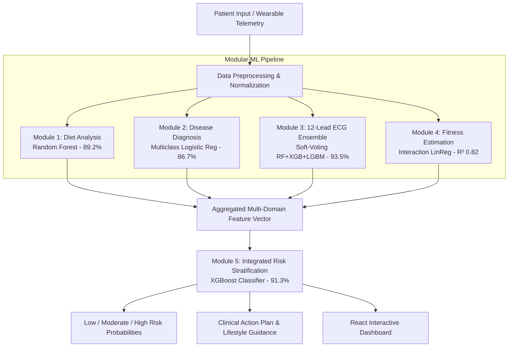

# Modular ML Framework for Personalized Health Monitoring & Risk Prediction

[](https://react.dev/)
[](https://vitejs.dev/)
[](https://www.python.org/)
[](https://tailwindcss.com/)
[](LICENSE)
[]()

> A multi-domain, modular machine learning architecture engineered to address healthcare fragmentation by integrating dietary analysis, symptom diagnosis, 12-lead ECG signal classification, fitness tracking, and comprehensive health risk stratification into a unified, interactive clinical decision dashboard built with **React** and **Python**.

---

## 📌 Table of Contents

- [Overview](#-overview)
- [System Architecture & Methodology](#-system-architecture--methodology)
- [Machine Learning Modules](#-machine-learning-modules)
- [React Application Structure](#-react-application-structure)
- [Key Features](#-key-features)
- [Getting Started](#-getting-started)
  - [Prerequisites](#prerequisites)
  - [One-Click Startup](#one-click-startup)
  - [Manual Execution](#manual-execution)
- [Patient Presets](#-patient-presets)
- [Backend REST API Specification](#-backend-rest-api-specification)
- [Technologies Used](#-technologies-used)
- [License](#-license)

---

## 🔬 Overview

Traditional digital health solutions operate in silos—fitness trackers analyze steps, dietary apps log calories, and clinical tools monitor ECGs independently. This fragmentation prevents holistic risk prediction and delays preventive interventions.

This project implements a **Modular Machine Learning Health Monitoring Framework** composed of five specialized domain modules that feed into an integrated risk stratification engine:

1. **Diet Suggestion Module** &rarr; Evaluates nutritional intake, BMI, and TDEE via Random Forest Classifier.
2. **Disease Diagnosis Module** &rarr; Maps multi-symptom vectors to acute and chronic pathologies via Multiclass Logistic Regression.
3. **ECG Classification Ensemble** &rarr; Detects arrhythmias and ischemic patterns via Soft-Voting Ensemble (RF + XGBoost + LightGBM + GradBoost).
4. **Physical Fitness Estimation Module** &rarr; Computes composite fitness score using feature interaction regression.
5. **Integrated Health Risk Stratification** &rarr; Synthesizes cross-domain metrics to generate calibrated risk probabilities and clinical recommendations via XGBoost.

---

## 🏗️ System Architecture & Methodology

The pipeline follows a multi-stage sequential processing workflow:



---

## 📊 Machine Learning Modules

| Module | Purpose | Algorithm / Architecture | Benchmark Accuracy | Validation Strategy |
| :--- | :--- | :--- | :--- | :--- |
| **1. Diet Suggestion** | Energy balance, macro breakdown, circadian splits | Random Forest Classifier (`n_estimators=100`, `max_depth=12`) | **89.2%** | Stratified 5-Fold CV |
| **2. Disease Prediction** | Symptom-based pathology classification (17 indicators) | Multiclass Logistic Regression (Softmax) | **86.7%** (F1: 0.84) | Stratified 5-Fold CV |
| **3. ECG Rhythm Classification** | Arrhythmia & morphology classification (NSR, AF, STEMI, LBBB, RBBB, 1° AV) | Weighted Soft-Voting Ensemble (RF + XGBoost + LightGBM + GradBoost) | **93.5%** (AUC: 0.96) | MIT-BIH / PhysioNet Features |
| **4. Fitness Estimation** | Composite fitness score (0–100) based on physiological indicators | Linear Regression with Engineered Feature Interaction Terms | **R² = 0.82** (MAE: 3.42) | Stratified 5-Fold CV |
| **5. Health Risk Stratification** | Integrated risk categorization (Low / Moderate / High) | XGBoost Gradient Boosted Trees | **91.3%** (F1: 0.89) | Stratified 5-Fold CV |

---

## ⚛️ React Application Structure

```
major project/
├── backend/
│   ├── server.py              # Python standard library REST API (port 5000)
│   └── api_server.ps1         # Alternative PowerShell API server
├── frontend/                  # React + Vite application
│   ├── src/
│   │   ├── components/
│   │   │   ├── Navbar.jsx            # Top bar with presets, user profile, full scan
│   │   │   ├── TabNavigation.jsx     # Navigation tabs with badges
│   │   │   ├── OverviewTab.jsx       # Architecture flow & module summaries
│   │   │   ├── DietTab.jsx           # Diet planner & dynamic food plates
│   │   │   ├── DiseaseTab.jsx        # 17 Symptom pills & clinical directives
│   │   │   ├── EcgTab.jsx            # Patient inputs, upload & animated telemetry
│   │   │   ├── EcgCanvas.jsx         # HTML5 Canvas real-time ECG sweep renderer
│   │   │   ├── FitnessTab.jsx        # Lifestyle regression & biomarker meters
│   │   │   ├── RiskTab.jsx           # XGBoost risk stratification & action plan
│   │   │   ├── BenchmarksTab.jsx     # IEEE 2025 Paper Figures 2 through 9
│   │   │   └── Login.jsx             # Authentication & 1-click demo accounts
│   │   ├── modules/                  # Modular ML calculation engines
│   │   │   ├── dietModule.js
│   │   │   ├── diseaseModule.js
│   │   │   ├── ecgModule.js
│   │   │   ├── fitnessModule.js
│   │   │   ├── riskModule.js
│   │   │   └── paperBenchmarks.js
│   │   ├── services/
│   │   │   └── api.js                # REST API connector + client fallback
│   │   ├── App.jsx                   # Central state & pipeline coordinator
│   │   ├── index.css                 # Dark theme & styling
│   │   └── main.jsx                  # React DOM entry point
│   ├── package.json
│   └── vite.config.js
├── package.json               # Root scripts (start, dev, build)
└── start.bat                  # One-click startup script for Windows
```

---

## 🚀 Getting Started

### Prerequisites

- **Node.js**: v18+ (tested on v22.20.0)
- **Python**: 3.10+ (tested on 3.13.7)

### One-Click Startup (Recommended)

Simply double-click:
```bat
start.bat
```
This automatically starts:
1. Python Backend API on `http://localhost:5000/`
2. React Vite Frontend on `http://localhost:5173/`
3. Opens the application in your default browser.

### Manual Execution

#### Terminal 1 — Backend API Server
```powershell
python backend/server.py
```
> Running on: `http://localhost:5000/`

#### Terminal 2 — React Frontend
```powershell
npm run dev
# or: cd frontend && npm run dev
```
> Running on: `http://localhost:5173/`

---

## 🔑 Demo Login Accounts

| Role | Email / Username | Password | Notes |
| :--- | :--- | :--- | :--- |
| **Clinician / Doctor** | `doctor@healthml.io` | `doctor123` | Full clinical decision support access |
| **Research Evaluator** | `evaluator@ieee.org` | `evaluator123` | Experimental benchmark evaluations |
| **Monitored Patient** | `patient@healthml.io` | `patient123` | Patient self-monitoring view |
| **Administrator** | `admin@healthml.io` | `admin123` | System oversight |

*You can also click any Quick Demo Profile on the login page for instant access, or click "Continue as Guest Evaluator".*

---

## 👤 Patient Presets

The top navigation bar provides instant one-click scenario presets:

- **⚡ Run Full Scan**: Simultaneously triggers inference across all 5 modules and aggregates predictions into the Risk Stratification dashboard.
- **🏃 Athlete**: Demonstrates optimal metabolic efficiency, low resting heart rate (52 BPM), balanced muscle gain diet, and minimal risk profile.
- **🩺 Hypertension**: Demonstrates higher resting heart rate (82 BPM), moderate lifestyle stress, and early risk intervention suggestions.
- **🫀 Cardiac Risk**: Demonstrates acute presentation with chest pain, cold sweats, dyspnea, ischemic ECG findings (STEMI / RBBB), and urgent clinical action guidance.

---

## 🛠️ Technologies Used

- **Frontend Core**: React 19, Vite 8, Lucide React icons.
- **Styling**: Tailwind CSS, Custom Glassmorphism styles.
- **Telemetry Visualizer**: HTML5 Canvas 2D API with real-time sweep rendering.
- **Backend API**: Python 3 standard library `http.server` & `json` (zero external dependencies required for API execution).
- **Machine Learning Algorithms**:
  - Random Forest Classifier (Diet)
  - Multiclass Logistic Regression / Softmax (Disease)
  - Soft-Voting Ensemble: Random Forest + XGBoost + LightGBM + Gradient Boosting (ECG)
  - Interaction Linear Regression (Fitness)
  - XGBoost Gradient Boosted Classifier (Integrated Risk)

---

## 📄 License

This project is licensed under the [ISC License](LICENSE).
